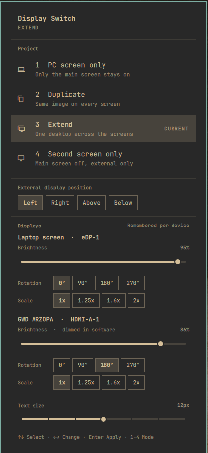

# Display Switch for Omarchy

Project to a second screen the way Windows does with <kbd>Win</kbd>+<kbd>P</kbd>:
**PC screen only**, **Duplicate**, **Extend** and **Second screen only**, from a
bar widget, a keyboard shortcut or the terminal. Each display's brightness,
rotation and scale are remembered **per device**, not per port.



## Why

Hyprland monitor rules are tied to a port. If your portable monitor is mounted
upside down (`transform = 2` on `HDMI-A-1`), then every screen you plug into that
port comes up upside down too: the projector at university, the TV at a friend's
place. Omarchy's built-in mirror also ignores the target's rotation, so the
duplicated image lands flipped.

Display Switch identifies each display by its EDID description (falling back to
the port for displays that send none) and keeps its rotation separately. Your
portable monitor stays at 180° and a projector on the same HDMI port comes up
straight, in every mode, including Duplicate.

## Features

- Four projection modes, like Windows: PC only, Duplicate, Extend, Second screen only
- Where the external display sits when extending: left, right, above, below
- Brightness per display: the real backlight or DDC/CI when the display has it,
  software dimming when it doesn't (most portable monitors and projectors)
- 0° / 90° / 180° / 270° rotation and scale per display, remembered per device
- Text size for the whole desktop, like Omarchy's display panel
- Duplicate honours the target display's rotation
- Re-applies your last mode when a display is plugged in or removed. If you unplug
  while on *Second screen only*, the laptop panel turns back on by itself.
- Keyboard driven: <kbd>1</kbd>–<kbd>4</kbd> pick a mode, arrows navigate, <kbd>Esc</kbd> closes
- Right-click the bar icon to cycle modes
- English and Spanish (follows the system locale, or set it in the widget settings)
- Survives Hyprland reloads and reboots; never edits your `monitors.lua`

## Requirements

- Omarchy Quattro (Hyprland with the Lua config, `omarchy-shell`)
- `jq` and `hyprctl` (both ship with Omarchy)

## Install

```bash
omarchy plugin add https://github.com/Slylem0/omarchy-display-switch.git --enable
```

The widget lands in the right section of the bar. Move it with
`omarchy bar move slylem0.display-switch --section left`.

### Keyboard shortcut (optional)

Plugins don't take over keys on their own. To get the Windows shortcut,
<kbd>Super</kbd>+<kbd>P</kbd> (Omarchy's "Pseudo window" by default), add this to
`~/.config/hypr/bindings.lua`:

```lua
hl.unbind("SUPER + P")
o.bind("SUPER + P", "Display switch", "omarchy-shell shell toggle slylem0.display-switch")

-- Optional: also replace Omarchy's display panel (Super+Ctrl+D)
-- hl.unbind("SUPER + CTRL + D")
-- o.bind("SUPER + CTRL + D", "Display switch", "omarchy-shell shell toggle slylem0.display-switch")

-- Or cycle modes directly, like pressing Win+P repeatedly
-- o.bind("SUPER + P", "Next display mode", os.getenv("HOME") .. "/.config/omarchy/plugins/slylem0.display-switch/bin/display-switch cycle")
```

The panel lives in the bar widget, so the shortcut needs the widget to be on
the bar (`--enable` puts it there).

## Use

| Action | How |
|---|---|
| Open the panel | Click the bar icon, or your shortcut |
| Pick a mode | Click it, or press <kbd>1</kbd>–<kbd>4</kbd> |
| Next mode | Right-click the bar icon |
| Change a display's brightness | Drag its *Brightness* slider, or select it and use <kbd>←</kbd>/<kbd>→</kbd> |
| Rotate or scale a display | Click a value under *Rotation* or *Scale*, or select the row and use <kbd>←</kbd>/<kbd>→</kbd> |
| Text size | The *Text size* slider at the bottom |
| Move the external display | *External display position* (shown while extended) |

### From the terminal

```bash
DS=~/.config/omarchy/plugins/slylem0.display-switch/bin/display-switch
$DS duplicate            # pc | duplicate | extend | second
$DS cycle                # next mode
$DS position left        # left | right | above | below
$DS rotate HDMI-A-1 2    # 0 normal, 1 90°, 2 180°, 3 270°, 4-7 flipped
$DS scale HDMI-A-1 1.25  # 0.5 to 4
$DS brightness HDMI-A-1 70
$DS state                # JSON
$DS reset                # drop the generated rules, back to monitors.lua
```

## How it works

The chosen layout is written as Hyprland Lua to
`~/.local/state/omarchy/toggles/hypr/display-switch.lua`. Omarchy loads every
file in that folder after `~/.config/hypr/monitors.lua` (it is the same mechanism
Omarchy's own toggles use), so these rules win for the displays that are
connected, and your `monitors.lua` stays the fallback for everything else.

Per-device rotation, scale, brightness and your last mode live in
`~/.local/state/display-switch/state.json`. The first time it runs, the plugin
adopts the rotation each connected display already has, so nothing flips on
install. Devices it sees later start at 0° until you rotate them.

### Brightness

For each display the plugin checks once whether it can control the real
brightness, using Omarchy's `omarchy-brightness-display` (laptop backlight,
DDC/CI monitors, Apple displays). External monitors need DDC/CI turned on in
their own menu, `ddcutil`, and access to `/dev/i2c-*`. The check can take a few
seconds on a display without DDC/CI; the answer is remembered.

When there is no hardware control, the display is dimmed in software: the
plugin's shell service draws a black, click-through layer over that screen.
It never goes below 10% so a screen can't be lost, it shows up in screenshots
and recordings of that screen, and it can't apply to a screen while it is the
mirror target in *Duplicate* (dim the source instead).

Choosing a mode clears Omarchy's own mirror / disable-laptop toggles so the two
don't fight. Omarchy's lid-closed (clamshell) handling is left untouched and
still wins when the lid is shut.

Every value written into the Lua file is checked against a strict pattern
first; a display with an unusual name is refused rather than quoted.

## Remove

```bash
omarchy plugin remove slylem0.display-switch
rm -f ~/.local/state/omarchy/toggles/hypr/display-switch.lua && hyprctl reload
rm -rf ~/.local/state/display-switch
```

## Development

```bash
./test/run                                   # helper (dry run) + Model.js tests
omarchy plugin validate .
qmllint -I "$OMARCHY_PATH/shell" ./*.qml
```

`DISPLAY_SWITCH_DRY_RUN=1` makes the helper print the Lua it would write
instead of applying it, and `DISPLAY_SWITCH_MONITORS_JSON` feeds it a fake
`hyprctl monitors all -j`.

---

## En español

Proyecta a una segunda pantalla como en Windows con <kbd>Win</kbd>+<kbd>P</kbd>:
**Solo pantalla del PC**, **Duplicar**, **Extender** y **Solo segunda pantalla**.
El brillo, el giro y la escala de cada pantalla se recuerdan **por dispositivo**,
no por puerto. El brillo usa el control real de la pantalla (portátil o DDC/CI)
y, si no lo tiene, la atenúa por software. Tu
monitor portátil montado al revés sigue a 180° y el proyector de la universidad,
en el mismo HDMI, sale derecho, también al duplicar.

```bash
omarchy plugin add https://github.com/Slylem0/omarchy-display-switch.git --enable
```

Para abrirlo con <kbd>Super</kbd>+<kbd>P</kbd> como en Windows, añade a
`~/.config/hypr/bindings.lua`:

```lua
hl.unbind("SUPER + P")
o.bind("SUPER + P", "Display switch", "omarchy-shell shell toggle slylem0.display-switch")
```

Para ver el panel en español aunque tu sistema esté en inglés, abre los ajustes
del widget (Setup › Bar) y pon **Language** en `es`.

## License

MIT
